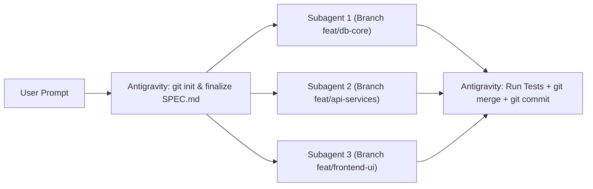
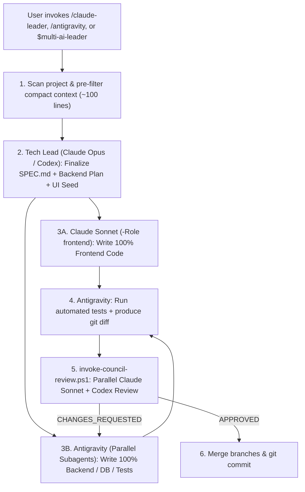

# 🚀 Multi-AI Coding Workflow: Antigravity (Gemini 4 Argon) + Claude Code + OpenAI Codex CLI

> 🌐 **Language / Ngôn ngữ**: **[🇬🇧 English (README.en.md)](README.en.md)** | **[🇻🇳 Tiếng Việt (README.md)](README.md)**

[](https://github.com/baoanhtsp/multi-ai-workflow/actions)
[](https://opensource.org/licenses/MIT)
[](https://github.com/baoanhtsp/multi-ai-workflow)


A production-grade **3-Way Omni-Directional Multi-AI Coding Orchestration** framework built around **Spec-Driven Development (SDD)**, **Git Branch Isolation**, and a **Bounded 2-Round Review Loop**. It combines **Google Antigravity**, **Claude Code CLI**, and **OpenAI Codex CLI** while saving **70%–85% of Claude tokens**, and includes a bilingual (**English / Vietnamese**) **Web Mission Control Dashboard** (`dashboard/index.html` + Node.js 24 native TypeScript `server/`).

---

## 🌟 1. Dual-Mode Architecture

The system operates in **2 smart modes** depending on project scale and requirements:

### Mode 1: Default Mode — Antigravity Multi-Subagent Branch Mode (Saves 100% of Claude/Codex Tokens)
When you open a new project in Antigravity and enter a normal request without invoking `/claude-leader`, **Antigravity (`Gemini 4 Argon`)** handles 100% of the work end-to-end using parallel subagent branches:



1. **Initialize Git & Finalize `SPEC.md`**: Ensures the project has a Git repository (`git init` + root commit) and a clear Schema/API contract (using `templates/SPEC.template.md`).
2. **Parallel Subagent Branching (`invoke_subagent`)**: Splits independent modules (Database, API, UI, Tests) across multiple subagents running concurrently on isolated branches (`Workspace: "share"` / `"branch"` or `git worktree`) with zero file collisions.
3. **Integrate, Test & Commit**: The lead Antigravity agent collects results, runs integration tests, merges branches (`git merge`), and commits cleanly.

---

### Mode 2: 3-Way Omni-Directional Multi-AI Team (`/claude-leader` • `/antigravity` • `$multi-ai-leader`)
When you want **Claude's industry-leading Frontend design** and **Parallel Dual-Review by Claude + OpenAI Codex**, any of the 3 AI platforms can act as the **Leader** and delegate tasks to the other two:
- **From Antigravity (`Gemini 4 Argon`)**: Type `/claude-leader`
- **From Claude Code (`Opus / Sonnet`)**: Type `/antigravity`
- **From OpenAI Codex Desktop / CLI (`GPT-6.1-Sol / GPT-6-Sol`)**: Type `$multi-ai-leader` (or ask naturally via `~/.codex/AGENTS.md`) so Codex acts as Tech Lead & Security Critic, calling Claude Sonnet for 100% Frontend (`invoke-claude.ps1 -Role frontend`) and Antigravity for Backend/Tests (`invoke-antigravity.ps1 -Action send-latest`).



---

## 🖥️ 2. Bilingual Web Mission Control Dashboard (`dashboard/` + `server/`)

Run `.\start-dashboard.ps1` (or `npm start` -> `http://127.0.0.1:4317/`) to launch the **Multi-AI Mission Control Dashboard v3.0** (Node.js 24 LTS + native TypeScript with real-time Server-Sent Events `SSE` job streaming and zero runtime dependencies—no PHP/Laragon required) featuring a **1-click `🇻🇳 VI | 🇬🇧 EN` Language Switcher** in the top header:

### How to Use the **Command Dispatcher & `SPEC.md` Generator**:
1. **Select Project & `Init SPEC.md`**:
   - Choose any project inside `C:\laragon\www`.
   - Status badges (`.git`, `SPEC.md`, `GEMINI.md`) show whether the repository is initialized.
   - Click **`Init SPEC.md`** to automatically create a Spec-Driven Development `SPEC.md` file in that project from `templates/SPEC.template.md`.
2. **Choose Orchestration Mode (Target AI)**:
   - **`Antigravity`**: Send Backend/Core/Test tasks directly into your active Antigravity IDE session.
   - **`Claude`**: Generate commands for `architect` (Opus), `frontend` (Sonnet — 100% UI), `reviewer` (Sonnet — grades `git diff`), or `ui-tweak` (Haiku).
   - **`Codex`**: Generate commands for `review-diff` (security/race-condition diff audit), `critic` (architecture critique), or `coder` (isolated worktree implementation).
   - **`Council`**: Run **Claude Sonnet + OpenAI Codex in parallel** (`invoke-council-review.ps1`).
3. **Select Role, Model Override & Reasoning Effort**:
   - Leave **Model Override** and **Reasoning Effort** on `Auto (Default)` to preserve the 80% token-saving routing, or override with any supported model (`claude-opus-5-5`, `claude-sonnet-5-5`, `claude-haiku-5-5`, `claude-fable-5-1`, `gpt-6.1-sol`, `gpt-6-astra`, `gpt-6-sol`, `gemini-4-argon`, etc.) and effort (`low`, `medium`, `high`, `xhigh`, `max`).
4. **Enter Prompt & Dispatch**:
   - **`Generate Command`**: Previews the exact PowerShell command with safe escaping.
   - **`Copy PowerShell`**: Copies the command to your clipboard.
   - **`Send Directly to Antigravity IDE`**: Dispatches the prompt straight into the running Antigravity IDE window for that project via the **Zero-Config Live Self-Healing Bridge**.

---

## 🧠 3. Biological Role Specialization & 80% Token Optimization

| Script & Role | Default Model & Flags | Responsibility | Share |
| :--- | :--- | :--- | :---: |
| **`invoke-claude.ps1`**<br>`-Role architect` | **Claude Opus 5.5**<br>`--effort high`<br>`--tools ""` | • System architecture, `SPEC.md` (DB & API Contract), and UI Design Seed.<br>• Disables built-in tools to save ~15,000 system prompt tokens. Supports `-PromptFile`, `-IncludeGitDiff`, `-ModelOverride`, `-EffortOverride`. | **10% – 15%** |
| **`invoke-claude.ps1`**<br>`-Role frontend` | **Claude Sonnet 5.5**<br>`--effort medium`<br>`--tools "Read,Edit,Write"`<br>`--add-dir <WorkDir>` | • Writes **100% of Frontend code** (`HTML`, `CSS`, `JS/TS`, `React`, `Vue`, `Blade`, `Tailwind`).<br>• Restricts search tools (`Grep`/`Bash`) and scopes file writes strictly to `--add-dir`. | **50% – 60%** |
| **`invoke-claude.ps1`**<br>`-Role reviewer` | **Claude Sonnet 5.5**<br>`--effort medium`<br>`--tools ""`<br>`-IncludeGitDiff` | • Pipes `git diff` safely via stdin (`-IncludeGitDiff`).<br>• Grades `X/10`, flags security/race-condition bugs, and outputs `CHANGES_REQUESTED` or `APPROVED`. | **15% – 20%** |
| **`invoke-claude.ps1`**<br>`-Role ui-tweak` | **Claude Haiku 5.5**<br>`--effort low`<br>`--tools "Read,Edit,Write"` | • Fast CSS, color, responsive layout, and copy adjustments. | **10% – 15%** |
| **`invoke-codex.ps1`**<br>`-Role review-diff`<br>`-Role critic` / `coder` | **OpenAI Codex CLI**<br>`GPT-6.1-Sol / GPT-6-Astra`<br>`--ephemeral` | • Independent 2nd reviewer: audits `git diff` for security flaws, data leaks, and edge cases.<br>• Writes complex algorithms/unit tests in an isolated `git worktree`, or leads via `$multi-ai-leader`. | **On-Demand** |
| **`invoke-council-review.ps1`**<br>`-WorkDir <path>` | **Claude Sonnet + Codex**<br>**Parallel Dual-Review**<br>+ **JSONL Audit Log** | • Runs **Claude Sonnet (`reviewer`)** and **OpenAI Codex (`review-diff`)** simultaneously via PowerShell Background Jobs (50% faster).<br>• Logs duration, scores, verdicts, and token estimates to `~/.gemini/antigravity/multi-ai-audit.jsonl`. | **High-Speed Council** |
| **`invoke-antigravity.ps1`**<br>`-Action send-latest`<br>`-WorkDir` | **Antigravity**<br>`Gemini 4 Argon (High)`<br>**Self-Healing Bridge** | • **Zero-Config Live Self-Healing Bridge**: Automatically discovers `language_server*.exe` Port & CSRF Token even after IDE restarts.<br>• Routes tasks to the exact project window (`-WorkDir`) and waits automatically (`600s` timeout, or `-NoWait` for async) to return full untruncated responses from `transcript_full.jsonl`. | **3-Way Bridge** |
| **`invoke-agent.ps1`**<br>`-Agent <id>`<br>`-Role architect\|leader\|backend\|frontend\|reviewer\|tester` | **Unified Role Dispatcher (v4.0)**<br>+ **Agent Registry (`agents.json`)**<br>+ **`invoke-cli-agent.ps1`** | • **Every AI is configuration**: Ships with 6 registered agents (`claude`, `codex`, `antigravity`, `gemini`, `cursor`, `aider`).<br>• Supports any custom CLI AI via `$MAW_HOME/agents.json` (`~/.maw/agents.json`) without code changes. | **Registry v4.0** |

### 🧩 Agent Registry v4.0 (`agents.json` & `~/.maw/agents.json`) — Add Any CLI AI Without Code Changes
v4.0 ships `antigravity/skills/claude-leader/agents.json` with 6 built-in & CLI agents:
- **`claude`** (`Claude Code`), **`codex`** (`OpenAI Codex`), and **`antigravity`** (`Antigravity IDE`).
- **`gemini`** (`Gemini CLI` — `gemini -p ... -o json` via `stdin`), **`cursor`** (`Cursor Agent CLI` — `cursor-agent -p --output-format text {prompt}`), and **`aider`** (`Aider` — `aider --message-file {prompt_file} ...`), executed via the generic CLI adapter **`invoke-cli-agent.ps1`**.
- **How to add or override an AI**: Create `~/.maw/agents.json` (or set `MAW_HOME`) with `"agents": [{ "id": "my-ai", "label": "My AI", "color": "#22c55e", "enabled": true, "adapter": "cli", "detect": { "command": "my-ai", "version_args": ["--version"] }, "models": ["default"], "efforts": [], "capabilities": { "write": true, "review": true, "new_session": false, "sessions": false, "ide_send": false }, "cli": { "command": "my-ai", "prompt_via": "stdin", "args": [], "role_args": {}, "model_args": ["-m", "{model}"], "effort_args": [], "output": "text" } }]`. Entries merge by `id` across `invoke-agent.ps1`, `invoke-council-review.ps1 -Reviewers`, `invoke-auto-gate.ps1 -Implementer/-Reviewers`, `invoke-spec-guard.ps1`, and `GET /api?action=status`.

---

## ⚡ 3b. Mission Control v5.0 Feature Suite (Streams S1–S6)

- **S1 — Git Isolation, Checkpoints & Best-of-N Worktrees**:
  - Automatic Git ref checkpoints (`refs/maw/checkpoints/<job>/<NNNN>`) before jobs and rounds, 1-click restore with safety snapshots, isolated worktree execution (`isolate: true`), parallel **Best-of-N** multi-agent comparison (`bestof_start`), branch merge (`worktree_merge`), and stale branch/worktree cleanup (`cleanup_preview` / `cleanup_apply`).
- **S2 — Kanban Task Board, Playbooks, Schedules & GitHub Sync**:
  - Dependency-aware Kanban board (`depends_on`), automated quality gate + Council Review on `review` transition, multi-step **Playbook** templates, recurring **Schedules**, and GitHub Issues import / PR creation via `gh` CLI.
- **S3 — Attention Inbox, Live Health Check, Unified Timeline, 2-Way Telegram & MCP Server**:
  - Unified **Attention Inbox** for approvals, gate failures, and budget blocks; live CLI login/quota health probes (`health_check`); chronological event `timeline`; 2-way **Telegram Bot** (`/status`, `/inbox`, `/approve`, `/deny`, `/run`, `/cancel`); and a stdio **MCP Server (`server/mcp/index.ts`)** for Claude, Codex, Cursor, and Gemini.
- **S4 — Cost & Budget Guardrails, Role Policy, Scoreboard & Auto-Fallback**:
  - Multi-scope spend caps (`day`, `agent_day`, `project`, `job`, `team_run`), role command policies with one-time approval claims (`policy_approve`), pre-review automated test gates (`checks_run`), empirical agent **Scoreboard**, and automatic fallback routing on cooldown or cap exhaustion.
- **S5 — Live Session Steer, Interactive Diff Review & File Explorer**:
  - Live job steering (`steer_send`, `steer_interrupt`, `steer_follow_up`, `session_resume`), hunk/line-level interactive diff review with structured fix requests (`review_submit`), and a read-only workspace **File Explorer** (`file_tree` / `file_read`).
- **S6 — Persistent Agent Profiles, Multi-Turn Chat Rooms, Handoffs, Shared Memory & Org Chart**:
  - Persistent workspace agent profiles (`.maw/agents/<id>/`), multi-agent **Chat Rooms** with `@mention` routing and structured `maw:handoff` task proposals, pinned project **Memory** notes (`.maw/memory/`), and **Teams / Org Chart** hierarchy management.

### 📌 v5.0 Operational Notes:
1. **One Server Instance per `MAW_HOME`**: Each `MAW_HOME` directory (default `~/.maw`) acquires an exclusive `server.lock` so background loops (`tasks`, `schedules`, `telegram`, `chat`) never double-fire.
2. **What to Track in Git under `.maw/`**:
   - **Recommended to commit**: `.maw/checks.json`, `.maw/playbooks/`, `.maw/agents/`, `.maw/teams.json`, and `.maw/memory/` to share team workflows, quality gates, and project knowledge.
   - **Optional / local state (can be gitignored)**: `.maw/tasks.json`, `.maw/chat/`, and `.maw/handoffs.json` if you prefer keeping runtime task/chat history local.

---

## 🛠️ 4. 1-Click Installation & Health Check (Windows PowerShell)

```powershell
git clone https://github.com/baoanhtsp/multi-ai-workflow.git
cd multi-ai-workflow
powershell -ExecutionPolicy Bypass -File .\install.ps1
powershell -ExecutionPolicy Bypass -File .\doctor.ps1
powershell -ExecutionPolicy Bypass -File .\start-dashboard.ps1
```

- **`install.ps1`**: Installs Global Rules, `/claude-leader` skills & scripts (including `start-dashboard.ps1`) into `~/.gemini/config/`, `CLAUDE.md` & `/antigravity` into `~/.claude/`, and `AGENTS.md` & `$multi-ai-leader` into `~/.codex/`.
- **`doctor.ps1`**: Verifies Node.js >= 22.18, Git, Claude CLI, Codex CLI, the Live Self-Healing Bridge (`agentapi-bridge.json` + live `language_server*.exe` process), global files, and Audit Log statistics.
- **`start-dashboard.ps1`**: Starts the Node.js 24 + native TypeScript Mission Control server on `http://127.0.0.1:4317/` (use `-Stop` to stop it).
