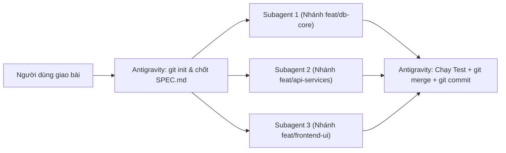
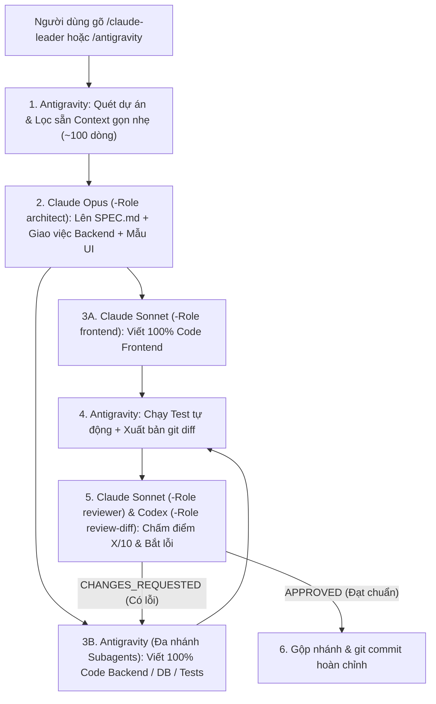

# 🚀 Multi-AI Coding Workflow: Antigravity (Gemini 4 Argon) + Claude Code + OpenAI Codex CLI

Hệ thống điều phối **Đa Tác Tử AI (Multi-AI Coding Orchestration)** theo kiến trúc **Spec-Driven Development (SDD)** + **Git Branch Isolation** + **Bounded Review Loop**, giúp kết hợp sức mạnh tốt nhất của cả 3 nền tảng AI hàng đầu hiện nay mà vẫn **tiết kiệm 70%–85% Token của Claude**.

---

## 🌟 1. Kiến trúc 2 Chế độ Vận hành (Dual-Mode Architecture)

Hệ thống được thiết kế thông minh với **2 chế độ tự động** tùy theo quy mô và nhu cầu của từng dự án:

### Chế độ 1: Mặc định khi mở dự án mới — Antigravity Multi-Subagent Branch Mode (Tiết kiệm 100% Token Claude/Codex)
Khi bạn mở một dự án mới và nhập yêu cầu bình thường (không gõ lệnh gọi Claude), **Antigravity (`Gemini 4 Argon`)** sẽ tự làm 100% từ A–Z theo quy trình phân nhánh chuẩn:



1. **Khởi tạo Git & Chốt `SPEC.md`**: Đảm bảo dự án có Git (`git init` + commit gốc) và thống nhất Schema/API Contract.
2. **Chia việc song song trên nhiều nhánh (`invoke_subagent`)**: Tách các module độc lập (Database, API, UI, Tests) cho nhiều Subagent chạy đồng thời trên các nhánh riêng (`Workspace: "share"` / `"branch"` hoặc `git worktree`) để không bao giờ ghi đè file của nhau.
3. **Tổng hợp, Kiểm thử & Commit**: Antigravity chính thu thập kết quả, chạy kiểm thử tích hợp, gộp nhánh (`git merge`) và thực hiện `git commit` sạch sẽ.

---

### Chế độ 2: Đội ngũ Đa AI (`/claude-leader` hoặc `/antigravity`) — Kết hợp Claude + Codex + Antigravity
Khi bạn muốn chất lượng **Frontend đạt chuẩn thẩm mỹ cao nhất của Claude** và có **Hội đồng Giám khảo (Claude + Codex) chấm điểm bắt lỗi chéo**:



---

## 🧠 2. Phân vai theo Điểm mạnh Sinh học & Tối ưu 80% Token Claude

### Bảng Phân tầng 3 Model của Claude (`invoke-claude.ps1`) + Codex (`invoke-codex.ps1`)

| Công cụ & Vai trò | Model & Cờ tối ưu | Nhiệm vụ chuyên trách | Tỷ trọng |
| :--- | :--- | :--- | :---: |
| **`invoke-claude.ps1`**<br>`-Role architect` | **Claude Opus**<br>`--effort high`<br>`--tools ""` | • Lên kiến trúc tổng thể, chốt `SPEC.md` (Database & API Contract).<br>• Thiết kế khuôn mẫu UI (Design System gốc).<br>• Tắt toàn bộ công cụ thừa để tiết kiệm 15.000 token hệ thống. | **10% – 15%** |
| **`invoke-claude.ps1`**<br>`-Role frontend` | **Claude Sonnet**<br>`--effort medium`<br>`--tools "Read,Edit,Write"` | • Trực tiếp viết **100% code Frontend** (`HTML`, `CSS`, `JS/TS`, `React`, `Vue`, `Blade`, `Tailwind`...).<br>• Khóa công cụ tìm kiếm (`Grep`/`Bash`), chỉ sửa đúng đường dẫn file được giao. | **50% – 60%** |
| **`invoke-claude.ps1`**<br>`-Role reviewer` | **Claude Sonnet**<br>`--effort medium`<br>`--tools ""` | • Đọc bản `git diff` + kết quả chạy Test của Antigravity.<br>• Chấm điểm (`X/10`), chỉ ra lỗi bảo mật/race-condition và chốt `CHANGES_REQUESTED` hoặc `APPROVED`. | **15% – 20%** |
| **`invoke-claude.ps1`**<br>`-Role ui-tweak` | **Claude Haiku**<br>`--effort low`<br>`--tools "Read,Edit,Write"` | • Tinh chỉnh nhanh CSS, màu sắc, responsive, đổi text hoặc kiểm tra khớp tên biến API. | **10% – 15%** |
| **`invoke-codex.ps1`**<br>`-Role review-diff`<br>`-Role critic` / `coder` | **OpenAI Codex CLI**<br>`codex review`<br>`--ephemeral` | • Giám khảo độc lập thứ 2: Chấm chéo `git diff` bắt lỗi thuật toán, rò rỉ dữ liệu, edge-cases.<br>• Hỗ trợ viết thuật toán khó hoặc Unit Test trên nhánh `git worktree` riêng. | **Theo yêu cầu** |
| **`invoke-antigravity.ps1`**<br>`-Action send-latest` | **Antigravity**<br>`Gemini 4 Argon (High)` | • Cầu nối để **Claude Code** trực tiếp bắn lệnh giao việc sang cửa sổ Antigravity đang mở và đọc báo cáo tiến độ (`-Action status`). | **Điều khiển 2 chiều** |

---

## 🛠️ 3. Hướng dẫn Cài đặt (1 Click trên Windows)

### Yêu cầu cài sẵn trên máy:
1. **Google Antigravity** (IDE hoặc Desktop App).
2. **Claude Code CLI** (`claude.exe`) — Đã đăng nhập một lần bằng lệnh `claude auth login`.
3. **OpenAI Codex CLI** (`npm i -g @openai/codex`) — Đã đăng nhập bằng lệnh `codex login`.
4. **Git** (`git --version`).

### Các bước cài đặt:
Clone repository này về máy và chạy script `install.ps1` bằng PowerShell:

```powershell
git clone https://github.com/<your-username>/multi-ai-workflow.git
cd multi-ai-workflow
powershell -ExecutionPolicy Bypass -File .\install.ps1
```

Script `install.ps1` sẽ tự động:
- Thay thế đường dẫn thư mục người dùng (`$env:USERPROFILE`) phù hợp với máy tính hiện tại.
- Cài đặt **Global Rules** & **Skill `/claude-leader`** vào `~/.gemini/config/`.
- Cài đặt **Bộ nhớ toàn cục `CLAUDE.md`** & **Lệnh tắt `/antigravity`** vào `~/.claude/`.

---

## 💻 4. Cách Sử dụng Thực tế

### Cách 1: Làm việc tự động 100% trên Antigravity (Mặc định)
* Mở thư mục dự án trên **Antigravity** và nhập thẳng yêu cầu.
* Antigravity sẽ tự động chia nhánh cho các **Subagent**, chạy kiểm thử, gộp nhánh và `git commit` (không tiêu tốn token của Claude hay Codex).

### Cách 2: Kích hoạt Đội ngũ Đa AI từ màn hình Antigravity (`/claude-leader`)
* Trong khung chat của **Antigravity**, gõ:
  ```text
  /claude-leader Hãy xây dựng tính năng X...
  ```
* Antigravity sẽ tự động lọc sẵn Context, gọi **Claude Opus** chốt `SPEC.md`, gọi **Claude Sonnet** viết 100% Frontend, tự code 100% Backend rồi nộp `git diff` cho **Claude Sonnet / Codex** chấm điểm đến khi đạt `APPROVED`.

### Cách 3: Kích hoạt từ màn hình Claude Desktop / Claude Code (`/antigravity`)
* Trong khung chat của **Claude Code**, gõ:
  ```text
  /antigravity Hãy thiết kế SPEC.md, tự làm Frontend và giao phần Backend cho Antigravity...
  ```
* Claude sẽ tự làm 100% Frontend và gọi `invoke-antigravity.ps1 -Action send-latest` để đánh thức cửa sổ **Antigravity (Gemini 4 Argon)** dậy làm Backend, sau đó tự kiểm tra kết quả và chấm điểm!

---

## 📂 5. Cấu trúc Thư mục Dự án

```text
multi-ai-workflow/
├── README.md                                              # Tài liệu hướng dẫn toàn diện
├── install.ps1                                            # Script cài đặt tự động 1-click
├── antigravity/
│   ├── hooks.json                                         # Hook tự động đồng bộ CSRF Token & Port cho Claude
│   ├── rules/
│   │   └── claude-leader-workflow.md                      # Luật toàn cục (Always-On Global Rule)
│   └── skills/
│       └── claude-leader/
│           ├── SKILL.md                                   # Định nghĩa kỹ năng & lệnh /claude-leader
│           └── scripts/
│               ├── invoke-claude.ps1                      # Điều phối Claude 3 tầng (Opus/Sonnet/Haiku)
│               ├── invoke-codex.ps1                       # Điều phối OpenAI Codex CLI (Review/Critic/Coder)
│               ├── invoke-antigravity.ps1                 # Cầu nối để Claude ra lệnh ngược cho Antigravity
│               └── save-agentapi-env.ps1                  # Tự động lưu CSRF Token ra agentapi-bridge.json
└── claude/
    ├── CLAUDE.md                                          # Bộ nhớ toàn cục cho Claude Code
    └── commands/
        └── antigravity.md                                 # Lệnh tắt /antigravity bên trong Claude Code
```
