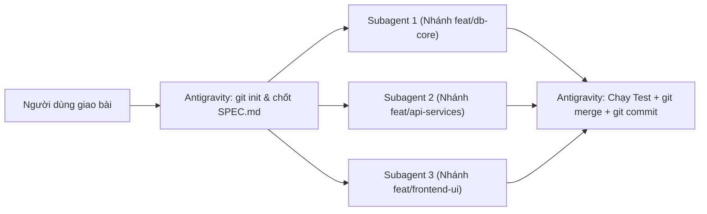
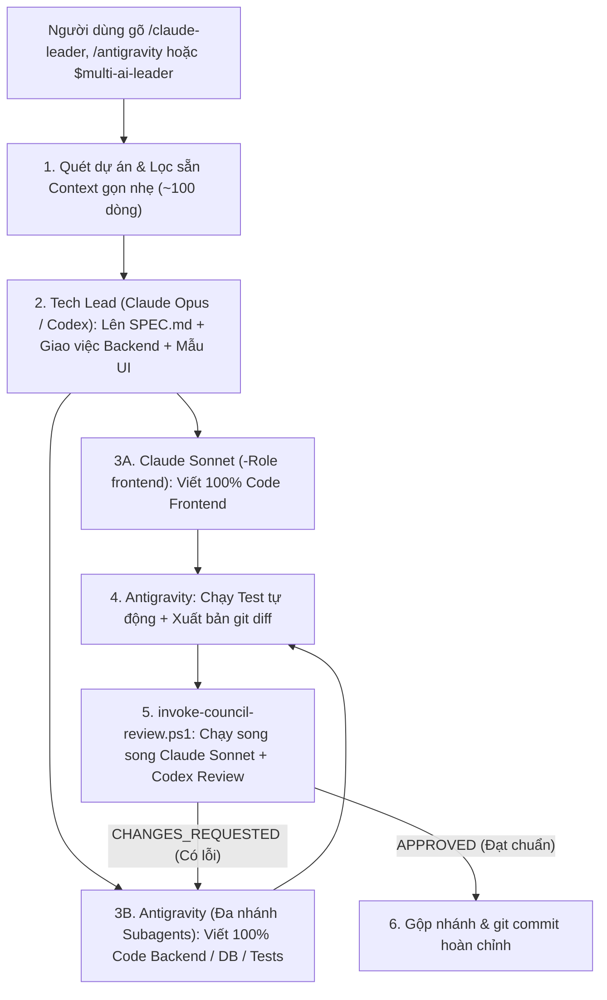

# 🚀 Multi-AI Coding Workflow: Antigravity (Gemini 4 Argon) + Claude Code + OpenAI Codex CLI

> 🌐 **Ngôn ngữ / Language**: **[🇻🇳 Tiếng Việt (README.md)](README.md)** | **[🇬🇧 English (README.en.md)](README.en.md)**

[](https://github.com/baoanhtsp/multi-ai-workflow/actions)
[](https://opensource.org/licenses/MIT)
[](https://github.com/baoanhtsp/multi-ai-workflow)


Hệ thống điều phối **Đa Tác Tử AI (Multi-AI Coding Orchestration)** theo kiến trúc **Spec-Driven Development (SDD)** + **Git Branch Isolation** + **Bounded Review Loop**, giúp kết hợp sức mạnh tốt nhất của cả 3 nền tảng AI hàng đầu hiện nay theo mô hình **Tam Giác Điều Phối 3 Chiều (3-Way Omni-Directional Orchestration)** mà vẫn **tiết kiệm 70%–85% Token của Claude**, kèm theo **Web Mission Control Dashboard song ngữ (`🇻🇳 VI | 🇬🇧 EN`)**.

---

## 🌟 1. Kiến trúc 2 Chế độ Vận hành (Dual-Mode Architecture)

Hệ thống được thiết kế thông minh với **2 chế độ tự động** tùy theo quy mô và nhu cầu của từng dự án:

### Chế độ 1: Mặc định khi mở dự án mới — Antigravity Multi-Subagent Branch Mode (Tiết kiệm 100% Token Claude/Codex)
Khi bạn mở một dự án mới và nhập yêu cầu bình thường (không gõ lệnh gọi Claude/Codex), **Antigravity (`Gemini 4 Argon`)** sẽ tự làm 100% từ A–Z theo quy trình phân nhánh chuẩn:



1. **Khởi tạo Git & Chốt `SPEC.md`**: Đảm bảo dự án có Git (`git init` + commit gốc) và thống nhất Schema/API Contract (theo mẫu chuẩn `templates/SPEC.template.md`).
2. **Chia việc song song trên nhiều nhánh (`invoke_subagent`)**: Tách các module độc lập (Database, API, UI, Tests) cho nhiều Subagent chạy đồng thời trên các nhánh riêng (`Workspace: "share"` / `"branch"` hoặc `git worktree`) để không bao giờ ghi đè file của nhau.
3. **Tổng hợp, Kiểm thử & Commit**: Antigravity chính thu thập kết quả, chạy kiểm thử tích hợp, gộp nhánh (`git merge`) và thực hiện `git commit` sạch sẽ.

---

### Chế độ 2: Đội ngũ Đa AI Tam Giác 3 Chiều (`/claude-leader` • `/antigravity` • `$multi-ai-leader`) — Kết hợp Claude + Codex + Antigravity
Khi bạn muốn chất lượng **Frontend đạt chuẩn thẩm mỹ cao nhất của Claude** và có **Hội đồng Giám khảo (Claude + Codex) chấm điểm bắt lỗi chéo song song**, hệ thống hỗ trợ **Tam Giác Điều Phối 3 Chiều (3-Way Omni-Directional Orchestration)**:
- **Từ Antigravity (`Gemini 4 Argon`)**: Gõ `/claude-leader`
- **Từ Claude Code (`Opus/Sonnet`)**: Gõ `/antigravity`
- **Từ OpenAI Codex Desktop / CLI (`GPT-6.1-Sol / GPT-6-Sol`)**: Gọi `$multi-ai-leader` (hoặc nhắn tự nhiên nhờ `~/.codex/AGENTS.md`) để Codex làm Tech Lead & Security Critic, tự động gọi Claude Sonnet viết 100% Frontend (`invoke-claude.ps1 -Role frontend`) và gọi Antigravity viết Backend/Test (`invoke-antigravity.ps1 -Action send-latest`).



---

## 🖥️ 2. Bảng Điều Khiển Web Song Ngữ (`dashboard/` + `server/` — Tiếng Việt & Tiếng Anh)

Chạy `.\start-dashboard.ps1` (hoặc `npm start` -> `http://127.0.0.1:4317/`) để khởi động **Multi-AI Mission Control Dashboard v3.0** (Node.js 24 LTS + native TypeScript, hỗ trợ luồng log thời gian thực qua Server-Sent Events `SSE`, không cần cài PHP/Laragon) và chuyển đổi **2 ngôn ngữ (`🇻🇳 VI | 🇬🇧 EN`)** ngay trên thanh Header:

### Hướng dẫn sử dụng mục **Command Dispatcher & `SPEC.md` Generator**:
1. **Chọn Dự Án & Nút `Init SPEC.md`**:
   - Chọn bất kỳ thư mục dự án nào trong `C:\laragon\www`.
   - 3 huy hiệu bên dưới (`.git`, `SPEC.md`, `GEMINI.md`) hiển thị trạng thái dự án (xanh lá = đã có, xám = chưa có).
   - Nếu dự án mới chưa có `SPEC.md`, bấm **`Init SPEC.md`** để tự động tạo file hợp đồng kiến trúc chuẩn từ `templates/SPEC.template.md`.
2. **Chọn Chế Độ Điều Phối (`Orchestration Mode`)**:
   - **`Antigravity`**: Giao việc Backend/Core/Test trực tiếp vào cửa sổ Antigravity IDE đang mở.
   - **`Claude`**: Tạo lệnh gọi `architect` (Opus), `frontend` (Sonnet — viết 100% giao diện), `reviewer` (Sonnet — chấm điểm `git diff`), hoặc `ui-tweak` (Haiku).
   - **`Codex`**: Tạo lệnh gọi `review-diff` (kiểm tra bảo mật/race-condition), `critic` (phản biện kiến trúc), hoặc `coder` (viết thuật toán/test trên nhánh riêng).
   - **`Council`**: Chạy **Hội đồng Giám khảo Song song** (`Claude Sonnet + OpenAI Codex` cùng lúc).
3. **Chọn Vai Trò (`Role`), Mô Hình (`Model Override`) & Mức Suy Luận (`Reasoning Effort`)**:
   - Có thể để mặc định `Auto` để hệ thống tự chọn model tiết kiệm 80% token, hoặc chủ động chọn bất kỳ model nào (`claude-opus-5-5`, `claude-sonnet-5-5`, `claude-haiku-5-5`, `claude-fable-5-1`, `gpt-6.1-sol`, `gpt-6-astra`, `gpt-6-sol`, `gemini-4-argon`...) và mức suy luận (`low`, `medium`, `high`, `xhigh`, `max`).
4. **Nhập Prompt & Thực thi (3 nút bên phải)**:
   - **`Generate Command` (Tạo lệnh)**: Sinh câu lệnh PowerShell chuẩn xác ở khung xem trước bên phải.
   - **`Copy PowerShell` (Sao chép)**: Copy nhanh lệnh vào Clipboard để dán vào Terminal.
   - **`Send Directly to Antigravity IDE` (Gửi thẳng tới Antigravity)**: Bắn trực tiếp yêu cầu từ trình duyệt web vào cửa sổ **Antigravity IDE** đang mở của dự án đó qua cầu nối Live Self-Healing Bridge!

---

## 🧠 3. Phân vai theo Điểm mạnh Sinh học & Tối ưu 80% Token Claude

### Bảng Phân tầng 3 Model của Claude (`invoke-claude.ps1`) + Codex (`invoke-codex.ps1`) + Hội đồng Song song (`invoke-council-review.ps1`)

| Công cụ & Vai trò | Model & Cờ tối ưu | Nhiệm vụ chuyên trách | Tỷ trọng |
| :--- | :--- | :--- | :---: |
| **`invoke-claude.ps1`**<br>`-Role architect` | **Claude Opus 5.5**<br>`--effort high`<br>`--tools ""` | • Lên kiến trúc tổng thể, chốt `SPEC.md` (Database & API Contract).<br>• Thiết kế khuôn mẫu UI (Design System gốc).<br>• Tắt toàn bộ công cụ thừa để tiết kiệm 15.000 token hệ thống. Hỗ trợ `-PromptFile`, `-IncludeGitDiff`, `-ModelOverride`, `-EffortOverride`. | **10% – 15%** |
| **`invoke-claude.ps1`**<br>`-Role frontend` | **Claude Sonnet 5.5**<br>`--effort medium`<br>`--tools "Read,Edit,Write"`<br>`--add-dir <WorkDir>` | • Trực tiếp viết **100% code Frontend** (`HTML`, `CSS`, `JS/TS`, `React`, `Vue`, `Blade`, `Tailwind`...).<br>• Khóa công cụ tìm kiếm (`Grep`/`Bash`), cấp quyền `--add-dir` vào đúng thư mục dự án để sửa file. | **50% – 60%** |
| **`invoke-claude.ps1`**<br>`-Role reviewer` | **Claude Sonnet 5.5**<br>`--effort medium`<br>`--tools ""`<br>`-IncludeGitDiff` | • Tự động đính kèm `git diff` qua stdin (`-IncludeGitDiff`) hoặc đọc từ `-PromptFile` an toàn.<br>• Chấm điểm (`X/10`), chỉ ra lỗi bảo mật/race-condition và chốt `CHANGES_REQUESTED` hoặc `APPROVED`. | **15% – 20%** |
| **`invoke-claude.ps1`**<br>`-Role ui-tweak` | **Claude Haiku 5.5**<br>`--effort low`<br>`--tools "Read,Edit,Write"`<br>`--add-dir <WorkDir>` | • Tinh chỉnh nhanh CSS, màu sắc, responsive, đổi text hoặc kiểm tra khớp tên biến API. | **10% – 15%** |
| **`invoke-codex.ps1`**<br>`-Role review-diff`<br>`-Role critic` / `coder` | **OpenAI Codex CLI**<br>`GPT-6.1-Sol / GPT-6-Astra`<br>`--ephemeral` | • Giám khảo độc lập thứ 2: Chấm chéo `git diff` bắt lỗi thuật toán, rò rỉ dữ liệu, edge-cases.<br>• Hỗ trợ viết thuật toán khó hoặc Unit Test trên nhánh `git worktree` riêng, hoặc làm **Tech Lead** qua `$multi-ai-leader`. | **Theo yêu cầu** |
| **`invoke-council-review.ps1`**<br>`-WorkDir <path>` | **Claude Sonnet + OpenAI Codex**<br>**Parallel Dual-Review**<br>+ **JSONL Audit Log** | • **Hội đồng Giám khảo Song song**: Kích hoạt đồng thời cả **Claude Sonnet (`reviewer`)** và **OpenAI Codex (`review-diff`)** bằng PowerShell Background Jobs, giảm **50% thời gian chờ**.<br>• Tự động ghi nhật ký kiểm toán vào `~/.gemini/antigravity/multi-ai-audit.jsonl`. | **Chấm chéo tốc độ cao** |
| **`invoke-antigravity.ps1`**<br>`-Action send-latest`<br>`-WorkDir` | **Antigravity**<br>`Gemini 4 Argon (High)`<br>**Self-Healing Bridge** | • **Zero-Config Live Self-Healing Bridge**: Tự động dò tiến trình `language_server*.exe` để lấy Port & CSRF Token mới nhất ngay cả khi khởi động lại IDE.<br>• Hỗ trợ `-WorkDir` (bắn lệnh đúng cửa sổ dự án đang mở) và tự động chờ code xong (`600s`) & trả về báo cáo đầy đủ từ `transcript_full.jsonl`. | **Điều khiển 3 chiều** |
| **`invoke-agent.ps1`**<br>`-Agent claude\|antigravity\|codex`<br>`-Role architect\|leader\|backend\|frontend\|reviewer\|tester` | **Unified Role Dispatcher (v2.2)**<br>+ **Role Brief Templates** | • **Bất kỳ AI nào cũng có thể nhận bất kỳ Role nào**: Đội hình mặc định `backend=antigravity, frontend=claude, reviewer=codex`, hoặc tùy chỉnh tự do.<br>• Lệnh gọi chuẩn: `invoke-agent.ps1 -Agent <agent> -Role <role> -WorkDir <path> [-Team "backend=antigravity,frontend=claude,reviewer=codex"] -PromptFile <file>`. | **Đa năng v2.2** |

---

## 🛠️ 4. Hướng dẫn Cài đặt & Kiểm tra Sức khỏe Hệ thống (1 Click trên Windows)

### Yêu cầu cài sẵn trên máy:
1. **Node.js 24 LTS** (tối thiểu `>= 22.18` để chạy TypeScript trực tiếp không cần bước build).
2. **Google Antigravity** (IDE hoặc Desktop App).
3. **Claude Code CLI** (`claude.exe`) — Đã đăng nhập một lần bằng lệnh `claude auth login`.
4. **OpenAI Codex CLI / Desktop** (`npm i -g @openai/codex`) — Đã đăng nhập bằng lệnh `codex login`.
5. **Git** (`git --version`).

### Các bước cài đặt & khởi chạy Dashboard:
Clone repository này về máy, chạy `install.ps1` để cài đặt, `doctor.ps1` để kiểm tra sức khỏe hệ thống, và `start-dashboard.ps1` để mở bảng điều khiển tại `http://127.0.0.1:4317/`:

```powershell
git clone https://github.com/baoanhtsp/multi-ai-workflow.git
cd multi-ai-workflow
powershell -ExecutionPolicy Bypass -File .\install.ps1
powershell -ExecutionPolicy Bypass -File .\doctor.ps1
powershell -ExecutionPolicy Bypass -File .\start-dashboard.ps1
```

---

## 📂 5. Cấu trúc Thư mục Dự án

```text
multi-ai-workflow/
├── .github/
│   └── workflows/
│       └── ci.yml                                         # GitHub Actions CI kiểm tra cú pháp PowerShell & Installer
├── .gitignore                                             # Loại trừ file tạm & SESSION_MEMORY.md
├── LICENSE                                                # Giấy phép nguồn mở MIT (Copyright 2026 baoanhtsp)
├── GEMINI.md                                              # Bộ nhớ ngữ cảnh dự án cho Antigravity
├── README.md                                              # Tài liệu hướng dẫn Tiếng Việt
├── README.en.md                                           # Tài liệu hướng dẫn Tiếng Anh (English Documentation)
├── install.ps1                                            # Script cài đặt tự động 1-click
├── doctor.ps1                                             # Công cụ chẩn đoán hệ thống & thống kê Audit Log
├── start-dashboard.ps1                                    # Khởi động / dừng Mission Control Server (http://127.0.0.1:4317/)
├── package.json                                           # Cấu hình Node.js 24 LTS + native TypeScript (0 runtime deps)
├── tsconfig.json                                          # Cấu hình TypeScript strict erasableSyntaxOnly
├── server/
│   ├── main.ts                                            # Điểm vào HTTP Server (127.0.0.1:4317) & quản lý vòng đời Job
│   ├── http.ts                                            # Định tuyến API, bảo mật Host/Origin/CSP & phục vụ file tĩnh
│   ├── actions/                                           # Các xử lý API (status, git, specGuard, dispatch, jobs, jobStream SSE, notify)
│   └── lib/                                               # Thư viện lõi (paths, commands, validate, proc, audit, versions)
├── dashboard/
│   └── index.html                                         # Giao diện Web Mission Control Song ngữ VI/EN (100% bởi Claude)
├── templates/
│   └── SPEC.template.md                                   # Mẫu hợp đồng SPEC.md chuẩn Spec-Driven Development
├── antigravity/
│   ├── rules/
│   │   └── claude-leader-workflow.md                      # Luật toàn cục (Always-On Global Rule)
│   └── skills/
│       └── claude-leader/
│           ├── SKILL.md                                   # Định nghĩa kỹ năng & lệnh /claude-leader
│           └── scripts/
│               ├── invoke-claude.ps1                      # Điều phối Claude (Opus/Sonnet/Haiku/Fable) + Audit Log
│               ├── invoke-codex.ps1                       # Điều phối OpenAI Codex CLI (Review/Critic/Coder) + Audit Log
│               ├── invoke-council-review.ps1              # Chấm chéo song song (Claude Sonnet + Codex CLI cùng lúc)
│               ├── invoke-antigravity.ps1                 # Cầu nối Self-Healing để Claude/Codex điều khiển Antigravity
│               └── save-agentapi-env.ps1                  # Tự động dò tiến trình & lưu CSRF Token/Port
├── claude/
│   ├── CLAUDE.md                                          # Bộ nhớ toàn cục cho Claude Code
│   └── commands/
│       └── antigravity.md                                 # Lệnh tắt /antigravity bên trong Claude Code
└── codex/
    ├── AGENTS.md                                          # Bộ nhớ toàn cục cho OpenAI Codex
    └── skills/
        └── multi-ai-leader/
            ├── SKILL.md                                   # Kỹ năng $multi-ai-leader trong Codex
            └── agents/
                └── openai.yaml                            # Cấu hình hiển thị trên Codex Desktop App
```
