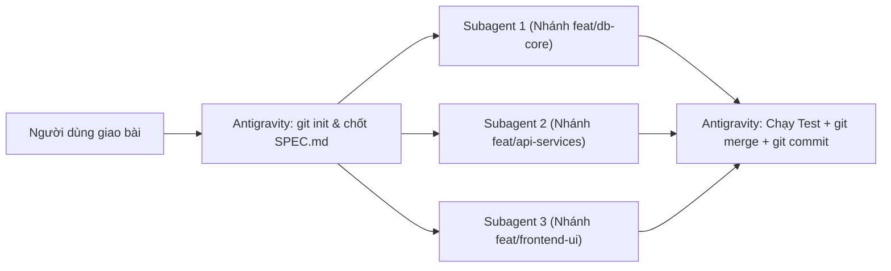
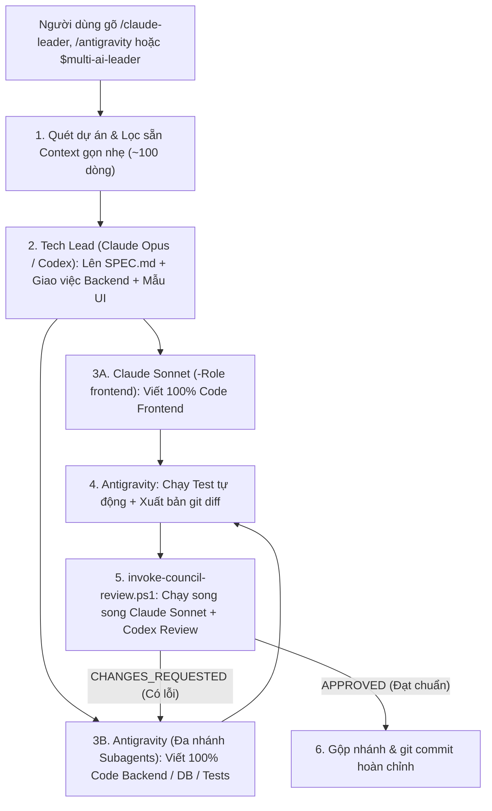

# 🚀 Multi-AI Coding Workflow: Antigravity (Gemini 4 Argon) + Claude Code + OpenAI Codex CLI

[](https://github.com/baoanhtsp/multi-ai-workflow/actions)
[](https://opensource.org/licenses/MIT)
[](https://github.com/baoanhtsp/multi-ai-workflow)


Hệ thống điều phối **Đa Tác Tử AI (Multi-AI Coding Orchestration)** theo kiến trúc **Spec-Driven Development (SDD)** + **Git Branch Isolation** + **Bounded Review Loop**, giúp kết hợp sức mạnh tốt nhất của cả 3 nền tảng AI hàng đầu hiện nay theo mô hình **Tam Giác Điều Phối 3 Chiều (3-Way Omni-Directional Orchestration)** mà vẫn **tiết kiệm 70%–85% Token của Claude**.

---

## 🌟 1. Kiến trúc 2 Chế độ Vận hành (Dual-Mode Architecture)

Hệ thống được thiết kế thông minh với **2 chế độ tự động** tùy theo quy mô và nhu cầu của từng dự án:

### Chế độ 1: Mặc định khi mở dự án mới — Antigravity Multi-Subagent Branch Mode (Tiết kiệm 100% Token Claude/Codex)
Khi bạn mở một dự án mới và nhập yêu cầu bình thường (không gõ lệnh gọi Claude/Codex), **Antigravity (`Gemini 4 Argon`)** sẽ tự làm 100% từ A–Z theo quy trình phân nhánh chuẩn:



1. **Khởi tạo Git & Chốt `SPEC.md`**: Đảm bảo dự án có Git (`git init` + commit gốc) và thống nhất Schema/API Contract (theo mẫu chuẩn `templates/SPEC.template.md`).
2. **Chia việc song song trên nhiều nhánh (`invoke_subagent`)**: Tách các module độc lập (Database, API, UI, Tests) cho nhiều Subagent chạy đồng thời trên các nhánh riêng (`Workspace: "share"` / `"branch"` hoặc `git worktree`) để không bao giờ ghi đè file của nhau.
3. **Tổng hợp, Kiểm thử & Commit**: Antigravity chính thu thập kết quả, chạy kiểm thử tích hợp, gộp nhánh (`git merge`) và thực hiện `git commit` sạch sẽ.

---

### Chế độ 2: Đội ngũ Đa AI Tam Giác 3 Chiều (`/claude-leader` • `/antigravity` • `$multi-ai-leader`) — Kết hợp Claude + Codex + Antigravity
Khi bạn muốn chất lượng **Frontend đạt chuẩn thẩm mỹ cao nhất của Claude** và có **Hội đồng Giám khảo (Claude + Codex) chấm điểm bắt lỗi chéo song song**, hệ thống hỗ trợ **Tam Giác Điều Phối 3 Chiều (3-Way Omni-Directional Orchestration)**:
- **Từ Antigravity (`Gemini 4 Argon`)**: Gõ `/claude-leader`
- **Từ Claude Code (`Opus/Sonnet`)**: Gõ `/antigravity`
- **Từ OpenAI Codex Desktop / CLI (`gpt-6-sol`)**: Gọi `$multi-ai-leader` (hoặc nhắn tự nhiên nhờ `~/.codex/AGENTS.md`) để Codex làm Tech Lead & Security Critic, tự động gọi Claude Sonnet viết 100% Frontend (`invoke-claude.ps1 -Role frontend`) và gọi Antigravity viết Backend/Test (`invoke-antigravity.ps1 -Action send-latest -Wait`).



---

## 🧠 2. Phân vai theo Điểm mạnh Sinh học & Tối ưu 80% Token Claude

### Bảng Phân tầng 3 Model của Claude (`invoke-claude.ps1`) + Codex (`invoke-codex.ps1`) + Hội đồng Song song (`invoke-council-review.ps1`)

| Công cụ & Vai trò | Model & Cờ tối ưu | Nhiệm vụ chuyên trách | Tỷ trọng |
| :--- | :--- | :--- | :---: |
| **`invoke-claude.ps1`**<br>`-Role architect` | **Claude Opus**<br>`--effort high`<br>`--tools ""` | • Lên kiến trúc tổng thể, chốt `SPEC.md` (Database & API Contract).<br>• Thiết kế khuôn mẫu UI (Design System gốc).<br>• Tắt toàn bộ công cụ thừa để tiết kiệm 15.000 token hệ thống. Hỗ trợ `-PromptFile` & `-IncludeGitDiff` qua stdin (chống lỗi nuốt biến `$` của PowerShell). | **10% – 15%** |
| **`invoke-claude.ps1`**<br>`-Role frontend` | **Claude Sonnet**<br>`--effort medium`<br>`--tools "Read,Edit,Write"`<br>`--add-dir <WorkDir>` | • Trực tiếp viết **100% code Frontend** (`HTML`, `CSS`, `JS/TS`, `React`, `Vue`, `Blade`, `Tailwind`...).<br>• Khóa công cụ tìm kiếm (`Grep`/`Bash`), cấp quyền `--add-dir` vào đúng thư mục dự án để sửa file. | **50% – 60%** |
| **`invoke-claude.ps1`**<br>`-Role reviewer` | **Claude Sonnet**<br>`--effort medium`<br>`--tools ""`<br>`-IncludeGitDiff` | • Tự động đính kèm `git diff` qua stdin (`-IncludeGitDiff`) hoặc đọc từ `-PromptFile` an toàn.<br>• Chấm điểm (`X/10`), chỉ ra lỗi bảo mật/race-condition và chốt `CHANGES_REQUESTED` hoặc `APPROVED`. | **15% – 20%** |
| **`invoke-claude.ps1`**<br>`-Role ui-tweak` | **Claude Haiku**<br>`--effort low`<br>`--tools "Read,Edit,Write"`<br>`--add-dir <WorkDir>` | • Tinh chỉnh nhanh CSS, màu sắc, responsive, đổi text hoặc kiểm tra khớp tên biến API. | **10% – 15%** |
| **`invoke-codex.ps1`**<br>`-Role review-diff`<br>`-Role critic` / `coder` | **OpenAI Codex CLI**<br>`codex review`<br>`--ephemeral`<br>`-IncludeGitDiff` / `-PromptFile` | • Giám khảo độc lập thứ 2: Chấm chéo `git diff` bắt lỗi thuật toán, rò rỉ dữ liệu, edge-cases (hỗ trợ `-PromptFile` & `-IncludeGitDiff`).<br>• Hỗ trợ viết thuật toán khó hoặc Unit Test trên nhánh `git worktree` riêng, hoặc làm **Tech Lead** qua `$multi-ai-leader`. | **Theo yêu cầu** |
| **`invoke-council-review.ps1`**<br>`-WorkDir <path>` | **Claude Sonnet + OpenAI Codex**<br>**Parallel Dual-Review**<br>+ **JSONL Audit Log** | • **Hội đồng Giám khảo Song song**: Kích hoạt đồng thời cả **Claude Sonnet (`reviewer`)** và **OpenAI Codex (`review-diff`)** bằng PowerShell Background Jobs, giảm **50% thời gian chờ**.<br>• Tự động ghi nhật ký kiểm toán (thời lượng, điểm số, trạng thái, ước tính token) vào `~/.gemini/antigravity/multi-ai-audit.jsonl`. | **Chấm chéo tốc độ cao** |
| **`invoke-antigravity.ps1`**<br>`-Action send-latest`<br>`-WorkDir` / `-Wait` | **Antigravity**<br>`Gemini 4 Argon (High)`<br>**Self-Healing Bridge** | • **Zero-Config Live Self-Healing Bridge**: Tự động dò tiến trình `language_server.exe` để lấy Port & CSRF Token mới nhất ngay cả khi khởi động lại IDE.<br>• Hỗ trợ `-WorkDir` (bắn lệnh đúng cửa sổ dự án đang mở) và `-Wait` (chờ code xong & trả về báo cáo đầy đủ từ `transcript_full.jsonl` chỉ trong 1 lệnh). | **Điều khiển 3 chiều** |

---

## 🛠️ 3. Hướng dẫn Cài đặt & Kiểm tra Sức khỏe Hệ thống (1 Click trên Windows)

### Yêu cầu cài sẵn trên máy:
1. **Google Antigravity** (IDE hoặc Desktop App).
2. **Claude Code CLI** (`claude.exe`) — Đã đăng nhập một lần bằng lệnh `claude auth login`.
3. **OpenAI Codex CLI / Desktop** (`npm i -g @openai/codex`) — Đã đăng nhập bằng lệnh `codex login`.
4. **Git** (`git --version`).

### Các bước cài đặt:
Clone repository này về máy, chạy `install.ps1` để cài đặt và chạy `doctor.ps1` để kiểm tra sức khỏe hệ thống:

```powershell
git clone https://github.com/baoanhtsp/multi-ai-workflow.git
cd multi-ai-workflow
powershell -ExecutionPolicy Bypass -File .\install.ps1
powershell -ExecutionPolicy Bypass -File .\doctor.ps1
```

- **Script `install.ps1` sẽ tự động**:
  - Thay thế đường dẫn thư mục người dùng (`$env:USERPROFILE`) phù hợp với máy tính hiện tại.
  - Cài đặt **Global Rules**, **Skill `/claude-leader`**, **Scripts** và **Mẫu `SPEC.template.md`** vào `~/.gemini/config/`.
  - Cài đặt **Bộ nhớ toàn cục `CLAUDE.md`** & **Lệnh tắt `/antigravity`** vào `~/.claude/`.
  - Cài đặt **Bộ nhớ toàn cục `AGENTS.md`** & **Skill `$multi-ai-leader`** vào `~/.codex/`.
- **Script `doctor.ps1` sẽ tự động**:
  - Kiểm tra phiên bản Git, Claude Code CLI, OpenAI Codex CLI, trạng thái cầu nối `agentapi-bridge.json` & tiến trình `language_server*.exe`.
  - Xác thực toàn bộ file cấu hình và thống kê lịch sử gọi AI / Token tiết kiệm từ `~/.gemini/antigravity/multi-ai-audit.jsonl`.

---

## 💻 4. Cách Sử dụng Thực tế

### Cách 1: Làm việc tự động 100% trên Antigravity (Mặc định)
* Mở thư mục dự án trên **Antigravity** và nhập thẳng yêu cầu.
* Antigravity sẽ tự động chia nhánh cho các **Subagent**, chạy kiểm thử, gộp nhánh và `git commit` (không tiêu tốn token của Claude hay Codex).

### Cách 2: Kích hoạt Đội ngũ Đa AI từ màn hình Antigravity (`/claude-leader`)
* Trong khung chat của **Antigravity**, gõ:
  ```text
  /claude-leader Hãy xây dựng tính năng X...
  ```
* Antigravity sẽ tự động lọc sẵn Context, gọi **Claude Opus** chốt `SPEC.md`, gọi **Claude Sonnet** viết 100% Frontend, tự code 100% Backend rồi nộp `git diff` (`-IncludeGitDiff`) cho **Claude Sonnet / Codex** chấm điểm đến khi đạt `APPROVED`.

### Cách 3: Kích hoạt từ màn hình Claude Desktop / Claude Code (`/antigravity`)
* Trong khung chat của **Claude Code**, gõ:
  ```text
  /antigravity Hãy thiết kế SPEC.md, tự làm Frontend và giao phần Backend cho Antigravity...
  ```
* Claude sẽ tự làm 100% Frontend và gọi `invoke-antigravity.ps1 -Action send-latest -WorkDir "<project>" -Wait` để đánh thức đúng cửa sổ **Antigravity (Gemini 4 Argon)** dậy làm Backend, tự động chờ nhận toàn bộ báo cáo không cắt cụt và chấm điểm `git diff`!

### Cách 4: Kích hoạt từ màn hình OpenAI Codex Desktop / CLI (`$multi-ai-leader`)
* Trong khung chat của **OpenAI Codex Desktop App** hoặc **Codex CLI**, gõ:
  ```text
  $multi-ai-leader Hãy chốt SPEC.md cho tính năng X, gọi Claude Sonnet viết 100% Frontend và gọi Antigravity viết Backend + Unit Tests...
  ```
* Nhờ bộ nhớ toàn cục `~/.codex/AGENTS.md` và skill `$multi-ai-leader`, **Codex (`gpt-6-sol`)** sẽ đóng vai **Tech Lead & Security Critic**: tự thiết kế `SPEC.md`, gọi `invoke-claude.ps1 -Role frontend` để giao 100% Frontend cho **Claude Sonnet**, đồng thời gọi `invoke-antigravity.ps1 -Action send-latest -WorkDir "<project>" -Wait` để điều khiển **Antigravity (`Gemini 4 Argon`)** viết Backend/Tests rồi chấm điểm `git diff`!

### Cách 5: Sử dụng Mẫu `SPEC.template.md` & Chấm chéo Song song (`invoke-council-review.ps1`)
* **Khởi tạo nhanh `SPEC.md` chuẩn SDD**: Sao chép `templates/SPEC.template.md` (hoặc `~/.gemini/config/skills/claude-leader/templates/SPEC.template.md`) vào thư mục dự án làm hợp đồng giao việc có sẵn **Ma trận Phân quyền File (Zero-Conflict Matrix)** và **Bảng Chấm điểm Tối đa 2 Vòng**.
* **Triệu tập Hội đồng Giám khảo Song song (Claude Sonnet + OpenAI Codex)**:
  ```powershell
  & "$env:USERPROFILE\.gemini\config\skills\claude-leader\scripts\invoke-council-review.ps1" `
    -WorkDir "C:\path\to\your\project" `
    -Prompt "Review Backend & API changes against SPEC.md"
  ```

---

## 📂 5. Cấu trúc Thư mục Dự án

```text
multi-ai-workflow/
├── .github/
│   └── workflows/
│       └── ci.yml                                         # GitHub Actions CI kiểm tra cú pháp PowerShell & Installer
├── .gitignore                                             # Loại trừ file tạm & SESSION_MEMORY.md
├── LICENSE                                                # Giấy phép nguồn mở MIT (Copyright 2026 baoanhtsp)
├── GEMINI.md                                              # Bộ nhớ ngữ cảnh dự án cho Antigravity
├── README.md                                              # Tài liệu hướng dẫn toàn diện
├── install.ps1                                            # Script cài đặt tự động 1-click
├── doctor.ps1                                             # Công cụ chẩn đoán hệ thống & thống kê Audit Log
├── dashboard/
│   ├── index.html                                         # Giao diện Web Mission Control (100% do Claude Sonnet thiết kế)
│   └── api.php                                            # Backend Telemetry & Command Dispatch API (8.5/10 APPROVED)
├── templates/
│   └── SPEC.template.md                                   # Mẫu hợp đồng SPEC.md chuẩn Spec-Driven Development
├── antigravity/
│   ├── rules/
│   │   └── claude-leader-workflow.md                      # Luật toàn cục (Always-On Global Rule)
│   └── skills/
│       └── claude-leader/
│           ├── SKILL.md                                   # Định nghĩa kỹ năng & lệnh /claude-leader
│           └── scripts/
│               ├── invoke-claude.ps1                      # Điều phối Claude 3 tầng (Opus/Sonnet/Haiku) + Audit Log
│               ├── invoke-codex.ps1                       # Điều phối OpenAI Codex CLI (Review/Critic/Coder) + Audit Log
│               ├── invoke-council-review.ps1              # Chấm chéo song song (Claude Sonnet + Codex CLI cùng lúc)
│               ├── invoke-antigravity.ps1                 # Cầu nối Self-Healing để Claude/Codex điều khiển Antigravity
│               └── save-agentapi-env.ps1                  # Tự động dò tiến trình & lưu CSRF Token/Port
├── claude/
│   ├── CLAUDE.md                                          # Bộ nhớ toàn cục cho Claude Code
│   └── commands/
│       └── antigravity.md                                 # Lệnh tắt /antigravity bên trong Claude Code
└── codex/
    ├── AGENTS.md                                          # Bộ nhớ toàn cục cho OpenAI Codex
    └── skills/
        └── multi-ai-leader/
            ├── SKILL.md                                   # Kỹ năng $multi-ai-leader trong Codex
            └── agents/
                └── openai.yaml                            # Cấu hình hiển thị trên Codex Desktop App
```

